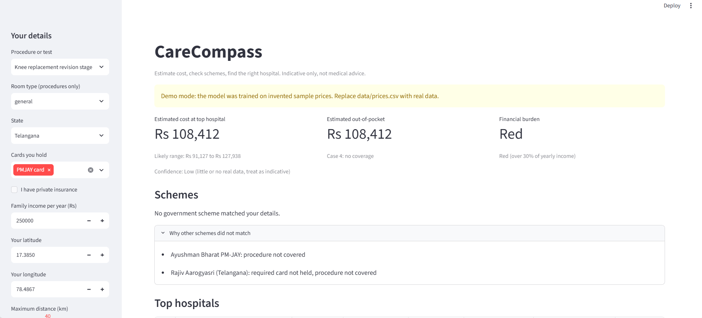
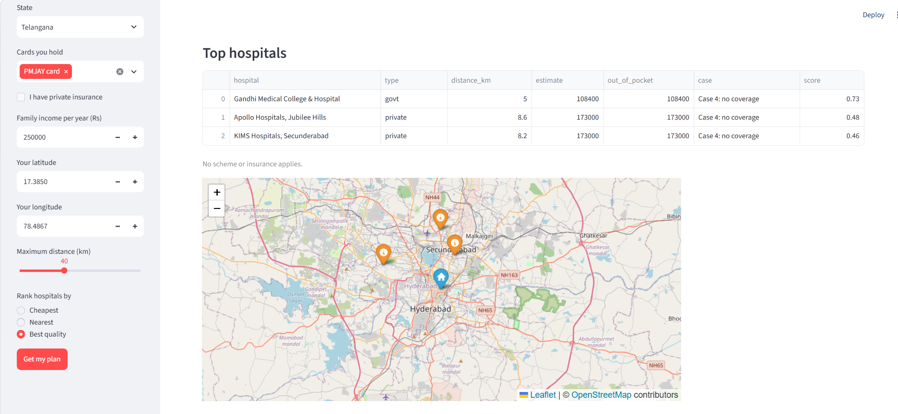

# CareCompass

A web app that helps a family estimate what a medical procedure or test might cost, check which government scheme or insurance could apply, and find suitable hospitals ranked by what they would actually pay.

Built for a hackathon problem statement on high out-of-pocket healthcare spending.
**Prototype. Not medical advice. Cost estimates are placeholders (see "Data status").**

## Screenshots
A procedure no scheme covers, so the family pays the full estimate (Case 4, Red burden band):



Ranked hospitals and the map:



## What it does
1. **Cost range:** predicts how far above or below the official reference rate a hospital will charge, then shows a range with a confidence label.
2. **Scheme check:** a rule engine checks eligibility and lists the documents to carry.
3. **Out-of-pocket:** handles four cases separately (scheme at an empanelled hospital, scheme at a non-empanelled hospital, private insurance, no coverage).
4. **Hospital ranking:** hard filters (offers the procedure, within distance), then a transparent weighted score using out-of-pocket cost, distance, rating and scheme acceptance.
5. **Extras:** fair-quote checker, savings tip, financial burden band.

## Data status
| File | Contents | Status |
|---|---|---|
| `data/procedures.csv` | Reference rates from the CGHS rates memo dated 03.10.2025 (Tier I, Non-NABH, semi-private ward) | Taken from the official memo |
| `data/schemes.json` | PM-JAY and Rajiv Aarogyasri rules with source link and last-checked date | Based on published scheme summaries (checked 2026-10-03); covered procedures not re-verified against the official package lists |
| `data/hospitals.csv` | Eight hospitals and diagnostic centres in and around Hyderabad | Real places with Google Maps locations; procedures, accreditation, ratings and scheme acceptance are indicative and not independently verified |
| `data/prices.csv` | Price observations the model learns from | **Synthetic demo data** (every row has `data_type = synthetic`) |

Because no public dataset of real hospital bills exists and none was collected, the cost model is trained on invented prices. The scores printed by `train.py` therefore measure how well the model relearns invented multipliers, not accuracy on real hospitals, and no accuracy claim is made. The app shows a demo-mode banner and a Low confidence label for this reason. Replacing `prices.csv` with sourced rows is enough to train on real data, with no code changes. Sources are listed in `sources.txt`.

## Demo run of the training pipeline (synthetic data, not accuracy)
```
WARNING: fewer than 20 real rows. Scores below are DEMO ONLY.
            model  MAE_rupees  MAPE_percent
            Ridge        4773          10.4
Gradient Boosting        4839          10.2
    Random Forest        5167          10.4
         Baseline        6961          13.3
```
These scores come from invented prices, so they only show that the pipeline runs end to end.

## Design decisions
- **Anchor + adjustment.** The model does not predict a raw price. It predicts the ratio (actual price / official reference rate) and multiplies it back, so the target stays near 1 and a small dataset goes further.
- **Rules, not ML, for eligibility.** Eligibility is yes or no. A probabilistic guess could send a family to the wrong hospital.
- **Weighted scoring, not a recommender.** A new platform has no user history, so collaborative filtering would not work (cold start). The score is also easy to explain.
- **Range from measured error.** The range is the 10th to 90th percentile of held-out error ratios.
- **Honest testing.** The pipeline evaluates only on real (non-synthetic) rows once 20 or more exist.

## Tests
- 9 unit tests on the rule logic (scheme matching, the four out-of-pocket cases, hospital filtering, quote and burden bands): `py -m pytest`
- Data validation before training: `py check_data.py`

## Run it
```
pip install -r requirements.txt
python check_data.py
python make_sample_data.py   # only if you have no real prices.csv yet (writes demo data)
python train.py
streamlit run app.py
pytest
```

## Project structure
```
engine.py          cost estimate, scheme rules, out-of-pocket, ranking
train.py           model comparison and range calculation
app.py             Streamlit interface with map
check_data.py      validates the data files
make_sample_data.py generates synthetic demo prices
tests/             unit tests for rules and calculations
data/              reference rates, prices, schemes, hospitals
screenshots/       images used in this README
sources.txt        where every data fact came from
```

## Limitations
- Cost estimates come from a model trained on synthetic prices (see "Data status").
- Pilot covers Hyderabad hospitals and a small set of procedures.
- Only hospital-stay procedures are matched to schemes. The PM-JAY expansion for citizens aged 70 and above is not modelled.
- Distance is straight-line (Haversine), not road distance.
- Scheme rules change. Each scheme record carries a source link and last-checked date.
- Estimates are indicative. Confirm with the hospital and the scheme office.
- No personal health records are stored.

## Possible next steps
Collect real published tariffs and retrain, model the 70+ card, road-distance routing, local-language interface, WhatsApp interface.